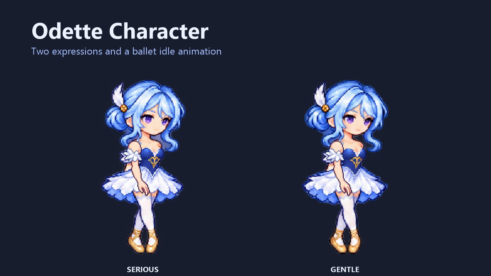

# OdetteCharacter · 奥黛塔



[下载 v1.0.0](https://github.com/ifgifg/OdetteCharacter/releases/tag/v1.0.0) · [报告问题](https://github.com/ifgifg/OdetteCharacter/issues)

源码仓库 / Source: [ifgifg/OdetteCharacter](https://github.com/ifgifg/OdetteCharacter)

独立的 tModLoader 完整玩家外观模组。启用后自动显示为奥黛塔：冰蓝短发与侧发髻、紫眼、深蓝舞衣、白羽芭蕾裙、金色足尖鞋。无需时装、饰品或聊天指令。

**Version 1.0.0.** Automatic, cosmetic-only player appearance with serious and gentle expressions, pointed-foot movement and four idle ballet poses. This is fan-made 2D sprite animation, not an official character release or a 3D model.

## 安装与表情

1. 安装 Terraria 与 tModLoader，保存并退出游戏。
2. 将发布的 `OdetteCharacter.tmod` 放入 tModLoader 的 `Mods` 文件夹；可从游戏模组界面打开它。Windows 默认位置为“文档\My Games\Terraria\tModLoader\Mods”。
3. 启用本模组；若正在使用 Vodyanitsa，请同时停用它或关闭其 Enabled 配置。重新加载后进入任意角色即可生效。
4. 模组配置 → 奥黛塔角色外观 → 温柔表情。默认严肃，切换立即应用于人物和头像。
5. 关闭本模组的启用选项或停用模组即可恢复原外观；不需要移除装备或重建角色。

配置为客户端本地设置，决定本客户端如何显示玩家，不写入原角色的发型、肤色、眼睛颜色或装备。

## 动作与玩法

每种表情有 12 个完整姿势：站立、四个足尖行走姿势、跳跃、下落、坐下/坐骑，以及准备、屈膝、立足尖、阿拉贝斯克四个闲置舞姿。

站稳且不操作 5 秒后播放四个舞姿，每姿势约 2/3 秒，随后恢复普通站姿一段时间再循环。移动、跳跃、使用物品、可见持物、钩爪、入水、坐下、坐骑和抚摸宠物等会取消舞姿，不锁定操作。

**这是纯外观模组。** 不修改生命、伤害、防御、速度、重力、呼吸、装备效果、控制输入或碰撞，也不增加自由游泳能力。水中继续使用原版玩法。关闭后存档中的原外貌仍在。

## 与沃雅妮莎同时安装

- **当 Vodyanitsa 模组及其 Enabled 配置都启用时，沃雅妮莎优先。** 本模组主动让位并提示，避免两套自动外观互相隐藏造成透明人物。
- 使用奥黛塔：停用 Vodyanitsa，或关闭它的 Enabled 配置。无需删除沃雅妮莎文件。
- 切回沃雅妮莎：启用 Vodyanitsa 并打开其配置；本模组可停用，或保留并自动让位。
- `OdetteVanity` 是另一个包含旧时装物品的模组，不是本模组依赖。可保留启用，旧物品仍存在，只是当前人物由完整外观替代。

本模组不会自行修改任何启用列表或其他模组的配置。

## 从源码构建

已验证环境：Windows、Terraria 1.4.4.9、tModLoader 2026.8.3.0、.NET 8 SDK。其他平台与 tModLoader 版本未验证；提供的脚本使用 Windows PowerShell 路径和目录联接。

保持源码目录名称为 `OdetteCharacter`，在该目录打开 PowerShell：

```powershell
.\build.ps1
# 只编译 C#：


[下载 v1.0.0](https://github.com/ifgifg/OdetteCharacter/releases/tag/v1.0.0) · [报告问题](https://github.com/ifgifg/OdetteCharacter/issues)
.\build.ps1 -CompileOnly
# 指定本机安装位置：


[下载 v1.0.0](https://github.com/ifgifg/OdetteCharacter/releases/tag/v1.0.0) · [报告问题](https://github.com/ifgifg/OdetteCharacter/issues)
.\build.ps1 -TMLPath 'D:\SteamLibrary\steamapps\common\tModLoader' -Dotnet 'C:\Program Files\dotnet\dotnet.exe'
```

默认路径为标准 Steam 安装目录及 `%LOCALAPPDATA%\Microsoft\dotnet\dotnet.exe`；不符合本机布局时通过参数覆盖。需要 .NET 8 SDK，游戏附带运行时本身不能完成 C# 编译。

输出为相邻 `OdetteCharacterBuild/release/OdetteCharacter.tmod`。打包使用独立 `build-runtime` 与 `build-save`，不安装、不启用模组，不读取真实人物或世界。游戏及 tModLoader 依赖需另行安装，不包含在仓库内。

## 已知限制与验证范围

- 这是预绘制二维切帧加独立前臂旋转/缩放，没有完整骨骼、背面 360 度旋转或原角色技能。
- 装备及其他模组的人物外观层被替换，装备效果仍保留。原生手持物、投射物、坐骑等继续绘制；剑、弓、火把和雨伞经过握点检查，不保证每种第三方武器都完全兼容。
- 人物图集保持自身颜色，不逐项复刻盔甲染料效果；环境光与原生受伤显示仍应用。
- 死亡/幽灵使用原版绘制；睡眠暂用坐姿外观。舞姿伸出的手脚属于外观，碰撞盒不会随之扩张。
- 完成了双表情各姿势、原生头像与持物、透明像素、实际人物更新中启用/禁用玩法一致性、双模组回退、专用服务器加载及目标整合包启动检查。**没有实测真实双客户端联机。** 服务器能加载不代表所有多人和第三方模组场景均通过。

## 源码与许可

`Common/` 为绘制、配置与闲置计时，`Assets/Character/` 为两套表情图集、手臂、头像和元数据，`Localization/` 为中英文本地化。参见 [ASSET-CONTRACT.txt](ASSET-CONTRACT.txt) 和 [PUBLIC-SOURCE-MANIFEST.txt](PUBLIC-SOURCE-MANIFEST.txt)。

原创贡献采用 [MIT License](LICENSE)。角色及其他既有第三方知识产权不由此授予，见 [THIRD_PARTY_NOTICES.md](THIRD_PARTY_NOTICES.md)。图集使用 AI 辅助生成；公开源码不包含研究参考图、拆包纹理、游戏二进制、个人配置或存档。
